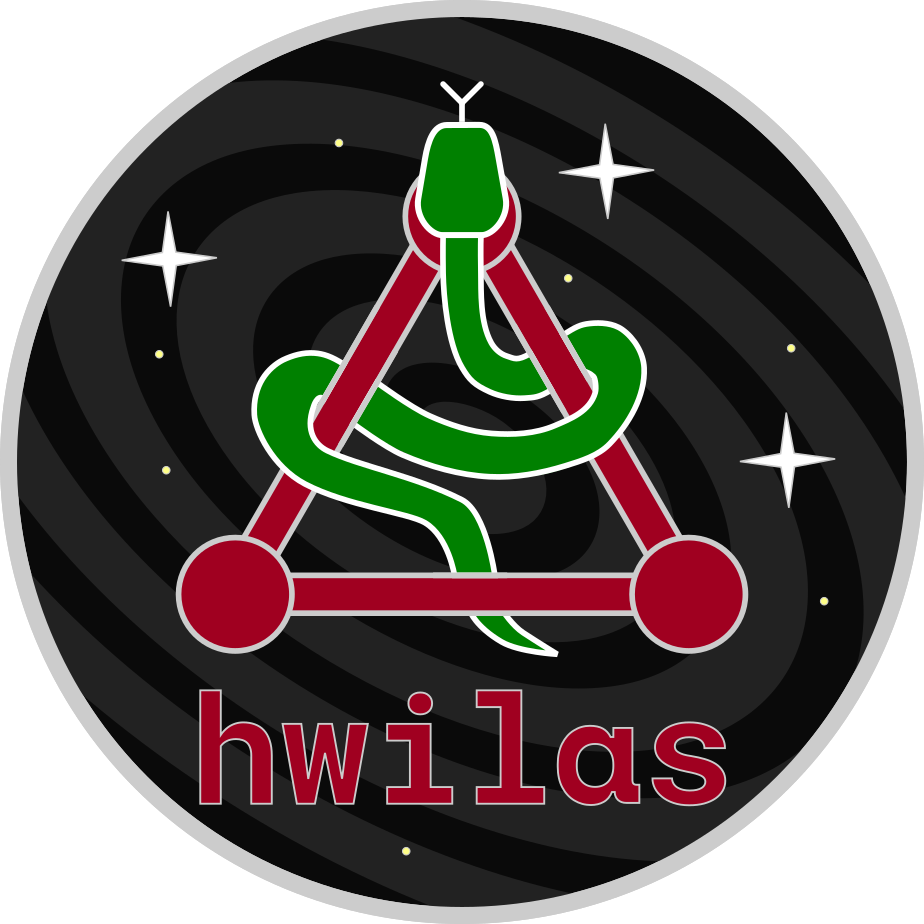

  

# Hwilas: Hierarchical Wave Inspiral LISA Analysis & Search

Here we provide a basic search for MBHB systems in LISA.

This is a template bank-based search, which utilises clustering techniques to reduce filesizes and
computational effort, as well as simple time slides for false alarm rate estimation.

The search is hierarchical, meaning we peform a first pass, remove N signals from the data, and then
perform the search again. This removes the very loudest signals from the data.

Hwilas (`/ˈʍiːlas/`, `wee-lass`) is the Cornish dialect word for search or seek. 
